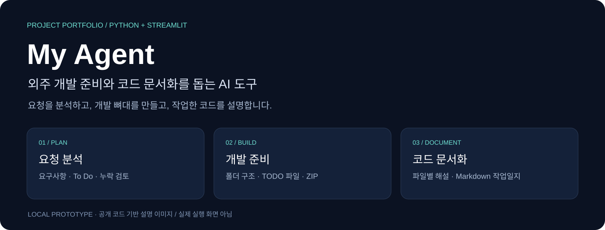
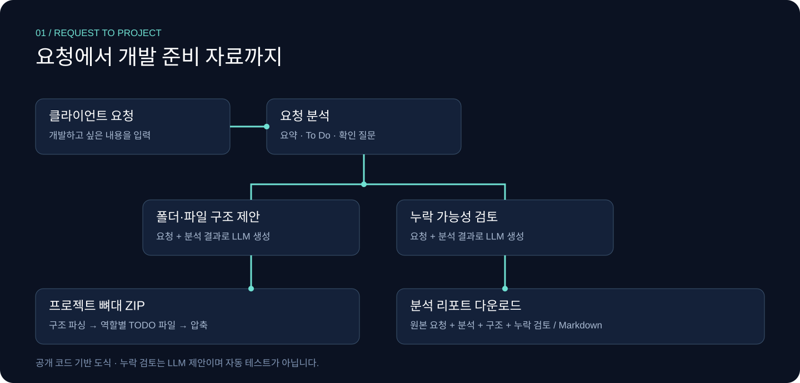
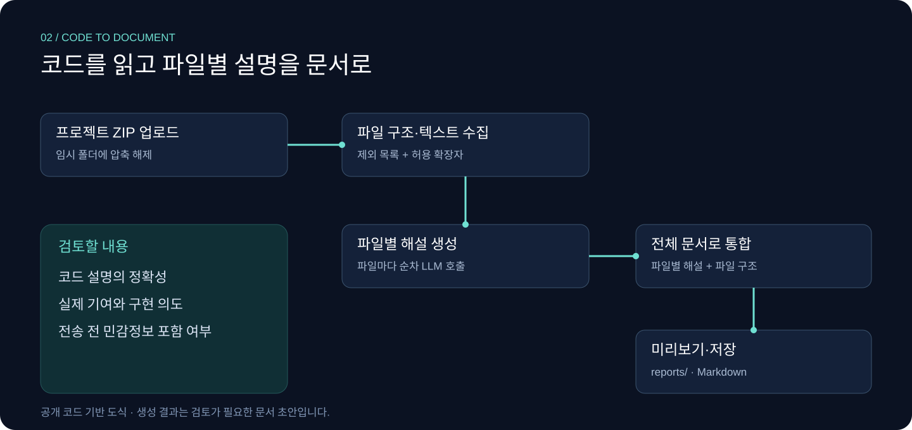

# My Agent · 외주 개발 에이전트

📌 프로젝트 유형 : 요구사항 분석·프로젝트 뼈대 생성·코드 문서화 도구  
🧩 구성 : Python · Streamlit · OpenAI API  
🔎 공개 코드 기준 : 로컬 실행형 프로토타입

> 클라이언트의 요청을 개발 To Do와 추천 파일 구조로 정리하고, 프로젝트 뼈대 ZIP을 생성하는 도구입니다. 기능별 구현 가이드를 확인하거나, 작업한 프로젝트 ZIP을 올려 코드 설명과 포트폴리오 작업일지 초안을 만들 수 있습니다.
>
> 아래 이미지는 실제 실행 화면이 아닌, 공개 코드의 구성을 설명하는 도식입니다. 운영 기간이나 사용 성과 등 확인되지 않은 내용은 포함하지 않았습니다.

<br />

# 목차

1. [프로젝트 소개](#-프로젝트-소개)
2. [처리 파이프라인](#-처리-파이프라인)
3. [핵심 기능](#-핵심-기능)
4. [기술 스택](#-기술-스택)
5. [프로젝트 구조](#-프로젝트-구조)
6. [설계 포인트](#-설계-포인트)
7. [실행 방법](#-실행-방법)
8. [현재 구현 범위와 개선 과제](#-현재-구현-범위와-개선-과제)
9. [포트폴리오 요약](#-포트폴리오-요약)

<br />

# 📖 프로젝트 소개

개발 요청을 받으면 필요한 기능을 나누고, 확인할 질문과 파일 구조를 정해야 합니다. 작업 후에는 코드가 맡은 역할을 다시 설명하는 문서도 필요합니다.

My Agent는 이 작업을 세 개의 탭으로 나눕니다.

| 탭 | 입력 | 결과 |
|---|---|---|
| 외주 요청 분석 | 클라이언트 요청 문장 | 요청 요약, 개발 To Do, 추천 파일 구조, 누락 검토, 분석 리포트, 프로젝트 뼈대 ZIP |
| 기능 구현 코드 리서치 | 구현할 기능과 선택적인 분석·구조 문맥 | 필요한 기술, 공식문서에서 확인할 항목, 구현 순서, 코드 뼈대 |
| 작업일지 작성 | 작업한 프로젝트 ZIP | 파일별 코드 해설, 통합 포트폴리오 작업일지, Markdown 저장 |

요청 분석과 문서 초안은 LLM이 생성합니다. 프로젝트 폴더·파일 생성, ZIP 압축, Markdown 저장은 Python 코드가 처리합니다.

<br />

# 🔁 처리 파이프라인



## 외주 요청 분석

1. 사용자가 요청 내용을 입력합니다.
2. 요청 분석 모듈이 요약, To Do, 필요한 기술, 확인 질문, 기본·추가 기능을 제안합니다.
3. 구조 설계 모듈이 요청과 분석 결과를 받아 폴더·파일 구조를 제안합니다.
4. 누락 검토 모듈이 기능, 예외처리, 납품 문서, 비용 범위와 위험 요소를 검토합니다.
5. 구조 문자열을 파싱해 파일별 역할과 TODO 주석이 들어간 프로젝트 뼈대를 만듭니다.
6. 프로젝트 ZIP과 분석 리포트를 다운로드합니다.

**ZIP에는 구현을 시작할 수 있는 파일 뼈대가 들어갑니다. 요청한 기능이 완성된 실행 프로그램을 생성하는 것은 아닙니다.**

## 기능 구현 가이드

구현할 기능에 전체 요청 분석과 파일 구조를 함께 입력하면, LLM이 해당 문맥에 맞는 구현 위치와 순서를 제안합니다.

화면의 이름은 “기능 구현 코드 리서치”이지만, 현재 코드에는 웹 검색이나 공식문서 조회 기능이 없습니다. 문서 링크, 라이브러리 사용법과 예시 코드는 직접 확인해야 합니다.

## 프로젝트 코드 문서화



1. 프로젝트 ZIP을 임시 폴더에 풉니다.
2. 읽기 대상 확장자와 제외 목록을 기준으로 파일 구조와 코드 내용을 수집합니다.
3. 각 파일을 순서대로 LLM에 전달해 코드·기능·구현 이유·개선점 설명을 생성합니다.
4. 파일별 설명과 파일 구조를 다시 LLM에 전달해 하나의 포트폴리오 문서로 정리합니다.
5. Streamlit에서 미리 본 후 서버의 `reports/` 폴더에 Markdown으로 저장합니다.

코드로부터 생성한 “구현 이유”는 작성자가 실제로 내린 결정을 보장하지 않습니다. 포트폴리오에 사용하기 전에 본인의 경험과 맞는지 검토해야 합니다.

<br />

# 📝 핵심 기능

| 기능 | 설명 | 코드 |
|---|---|---|
| 요청 분석과 To Do 생성 | 개발 작업마다 추천 파일명을 붙이고, 확인 질문과 추가 비용 가능 항목을 정리합니다. | [request_analyzer.py](./tools/request_analyzer.py) |
| 폴더·파일 구조 제안 | 요청에 맞는 언어·프레임워크와 MVP 기준의 구조를 제안합니다. | [file_structure_generator.py](./tools/file_structure_generator.py) |
| 누락 가능성 검토 | 요청과 분석을 비교해 기능·예외처리·납품 문서 등의 검토 초안을 만듭니다. | [missing_checker.py](./tools/missing_checker.py) |
| 프로젝트 뼈대 ZIP | 경로와 역할을 읽어 폴더·파일을 만들고, 역할별 TODO 주석을 넣어 압축합니다. | [project_scaffolder.py](./tools/project_scaffolder.py) |
| 구현 가이드 생성 | 기술, 공식문서 확인 항목, 구현 순서, 짧은 코드 뼈대를 제안합니다. | [feature_code_researcher.py](./tools/feature_code_researcher.py) |
| 프로젝트 ZIP 읽기 | 제외 폴더·파일명과 허용 확장자를 기준으로 텍스트 파일을 수집합니다. | [project_reader.py](./tools/project_reader.py) |
| 파일별 코드 해설 | 실제 코드를 기능 단위로 나눠 설명하는 문서 초안을 생성합니다. | [file_portfolio_generator.py](./tools/file_portfolio_generator.py) |
| 통합 작업일지 작성 | 파일별 설명과 구조를 하나의 Markdown 문서로 정리하고 저장합니다. | [dev_journal_writer.py](./tools/dev_journal_writer.py) |

누락 검토는 LLM의 제안이며, 프로그램 실행 검사나 자동 테스트를 대신하지 않습니다.

<br />

# ✨ 기술 스택

<p align="left">
  
  
  
  
</p>

| 기술 | 맡은 역할 |
|---|---|
| Python | 파일 읽기, 구조 파싱, 뼈대 파일 생성, ZIP 압축, 문서 저장 |
| Streamlit | 세 개의 작업 탭, 텍스트 입력, ZIP 업로드·다운로드, 문서 미리보기 |
| OpenAI Python SDK | 요청 분석, 구조 제안, 구현 가이드, 코드 설명과 통합 문서 생성 |
| gpt-4o-mini | 공개 코드의 기본 모델. 일부 모듈은 모델명을 고정 사용합니다. |
| python-dotenv | 로컬 `.env`의 API 키와 설정 읽기 |
| zipfile · tempfile · os · re | ZIP 처리, 임시 폴더, 경로·파일 조작, 구조 문자열 파싱 |

`langchain-openai`는 의존성 목록에 있으나, 확인한 앱 실행 코드에서는 사용하지 않습니다. 현재 LLM 호출은 OpenAI SDK로 직접 수행합니다.

<br />

# 🗂 프로젝트 구조

```text
my_agent/
├─ main.py                            # Streamlit UI와 기능 연결
├─ requirements.txt                   # 의존성 목록
├─ tools/
│  ├─ request_analyzer.py              # 요청 분석과 개발 To Do
│  ├─ file_structure_generator.py      # 추천 폴더·파일 구조
│  ├─ missing_checker.py               # 누락 가능성 검토
│  ├─ report_writer.py                 # 분석 리포트 조립
│  ├─ project_scaffolder.py             # TODO 기반 파일 뼈대와 ZIP
│  ├─ feature_code_researcher.py        # 기능 구현 가이드
│  ├─ project_reader.py                 # 업로드 ZIP의 코드·구조 읽기
│  ├─ file_portfolio_generator.py       # 파일별 코드 설명 생성
│  ├─ dev_journal_writer.py             # 통합 작업일지 생성·저장
│  ├─ project_type_detector.py          # 유형 분류 모듈, 결과 연결 미완료
│  └─ code_search_helper.py             # 검색어 제안 모듈, UI 미연결
├─ reports/                            # 저장된 Markdown 리포트
├─ docs/assets/readme/                 # 포트폴리오 설명 이미지
└─ README.md
```

실행 시 `generated_projects/` 아래에 뼈대 폴더와 ZIP이 생성되고, 업로드한 프로젝트는 임시 폴더에서 읽습니다. 위 구조는 앱 소스 중심으로 정리했습니다.

<br />

# 🧩 설계 포인트

## 작업별 LLM 호출 분리

요청 분석, 구조 설계, 누락 검토, 코드 설명을 각각 별도 함수와 프롬프트로 분리했습니다. 앞 단계의 분석을 다음 단계에 전달하며, UI는 `main.py`에서 연결합니다.

현재는 버튼 실행에 따라 함수를 순서대로 호출하는 방식입니다. 모델이 도구를 선택해 자율적으로 반복 실행하는 구조는 아닙니다.

## 파일 역할에 따른 TODO 구성

`project_scaffolder.py`는 파일 경로와 역할의 키워드를 확인해 UI, API, 크롤링, RAG 등과 관련된 작업 항목을 주석으로 작성합니다. 확장자에 따라 Python·JavaScript·HTML 등의 주석 형식을 구분합니다.

이 키워드 분기는 개발 안내용 템플릿입니다. RAG나 크롤링 기능이 My Agent 자체에 구현되어 있다는 의미는 아닙니다.

## 파일 단위 해설 후 통합

프로젝트 전체를 곧바로 하나의 문서로 요약하지 않고, 파일별 코드 설명을 먼저 생성한 뒤 전체 문서로 합칩니다. 파일별 호출에는 코드 앞부분 최대 16,000자를 전달합니다.

전체 파일 수와 최종 통합 입력에는 별도 제한이 없어, 큰 프로젝트는 호출 비용과 모델 입력 길이를 고려해야 합니다.

<br />

# 💻 실행 방법

## 설치

저장소를 내려받은 뒤 프로젝트 폴더에서 실행합니다.

```bash
git clone https://github.com/dltkdgur1123/my_agent.git
cd my_agent
python -m venv .venv
```

가상환경을 활성화합니다.

```powershell
# Windows PowerShell
.\.venv\Scripts\Activate.ps1
```

```bash
# macOS / Linux
source .venv/bin/activate
```

```bash
python -m pip install -r requirements.txt
```

## 환경변수

프로젝트 루트에 `.env`를 만들고 본인의 API 키를 설정합니다.

```dotenv
OPENAI_API_KEY=your_openai_api_key
OPENAI_MODEL=gpt-4o-mini
```

`OPENAI_MODEL`은 구현 가이드, 프로젝트 유형 분류, 코드 문서화 모듈에 적용됩니다. 요청 분석·파일 구조 제안·누락 검토·검색어 제안 모듈은 `gpt-4o-mini`를 고정 사용합니다.

## 실행

```bash
python -m streamlit run main.py
```

브라우저에서 터미널에 표시된 로컬 주소를 엽니다. 분석과 문서 생성에는 OpenAI API 호출이 필요하며 API 사용 비용이 발생합니다.

프로젝트 ZIP과 분석 리포트는 화면에서 다운로드할 수 있습니다. 작업일지의 “Markdown 파일로 저장”은 앱을 실행한 컴퓨터의 `reports/` 폴더에 저장합니다.

<br />

# 🔎 현재 구현 범위와 개선 과제

이 문서는 공개 소스 검토를 기준으로 작성했습니다. 이번 README 정리 과정에서 API 호출, 앱 실행, 생성 ZIP의 실행 가능성은 검증하지 않았습니다.

| 항목 | 현재 상태 | 개선 과제 |
|---|---|---|
| 프로젝트 유형 분류 | 분류 함수는 호출하지만 결과를 세션에 저장하지 않고, 리포트에는 빈 문자열을 전달합니다. | 화면·리포트에 분류 결과 연결 |
| 분석 리포트 | Markdown 조립 함수의 파일 구조 코드 블록에 닫는 구분자가 없습니다. | 다운로드 문서의 Markdown 형식 수정 |
| 구조 파싱 | 트리 문자열의 경로·역할을 추출하지만 들여쓰기로 부모 경로를 복원하지 않습니다. | 중첩 구조와 경로 유효성 검증 |
| 오류 처리 | 빈 입력 안내는 있으나 API 오류·타임아웃에 대한 공통 처리와 재시도는 없습니다. | 실패 안내와 재시도 처리 |
| 대용량 문서화 | 파일별 순차 호출 후 결과 전체를 통합 입력으로 전달합니다. | 파일 수·크기 제한과 분할 요약 |
| ZIP과 생성 경로 | ZIP 해제와 생성 경로에 대한 앱 수준의 경로·용량 검사가 없습니다. | 경로 이탈·용량 검사, 임시 파일 정리 |
| 민감 파일 제외 | 일부 환경변수 파일명과 개발 폴더를 제외합니다. 모든 비밀 파일을 탐지하지는 않습니다. | 전송 전 파일 목록 확인과 제외 규칙 확장 |

## 데이터 취급

업로드한 ZIP 중 읽기 대상으로 선택된 코드·텍스트는 문서 생성을 위해 OpenAI API로 전송됩니다. 고객 코드, 인증정보, 개인정보가 들어 있는 파일은 업로드 전에 제거해야 합니다.

`.env`, `.env.local`, `.env.production` 등 일부 파일은 읽기에서 제외하지만, 다른 이름의 키 파일이나 코드 안에 들어 있는 비밀값까지 자동으로 제거하지 않습니다.

공개 저장소에는 가상환경과 캐시 파일도 포함되어 있습니다. 저장소 경량화와 생성물 정리는 별도 개선 과제로 남겨두었습니다.

<br />

# 📌 포트폴리오 요약

## Problem

개발 요청을 실행할 작업과 파일 구조로 바꾸는 일, 작업 후 코드 설명 문서를 만드는 일에는 반복적인 정리가 필요합니다.

## Action

요청 분석·구조 설계·누락 검토를 별도 모듈로 나누고 Streamlit에 연결했습니다. 제안된 구조에서 TODO 기반 프로젝트 ZIP을 만들고, 기존 프로젝트 ZIP에서는 파일별 해설과 통합 작업일지 초안을 생성하도록 구성했습니다.

## Result

하나의 로컬 앱에서 개발 준비 자료와 코드 설명 문서를 생성할 수 있는 프로토타입으로 구성되어 있습니다. 현재 코드에서 확인되는 산출물은 다음과 같습니다.

- 요청 분석·To Do·누락 검토를 담은 Markdown 리포트
- 파일별 역할과 TODO 주석이 들어간 프로젝트 뼈대 ZIP
- 기능별 구현 가이드
- 프로젝트 코드에 기반한 포트폴리오 작업일지 초안

생성 결과의 정확성, 실행 가능한 코드 여부, 실제 기여와 구현 의도는 사용자가 검토해야 합니다.
